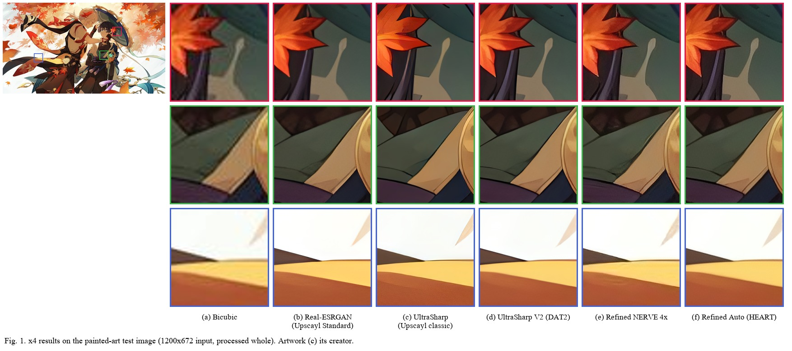
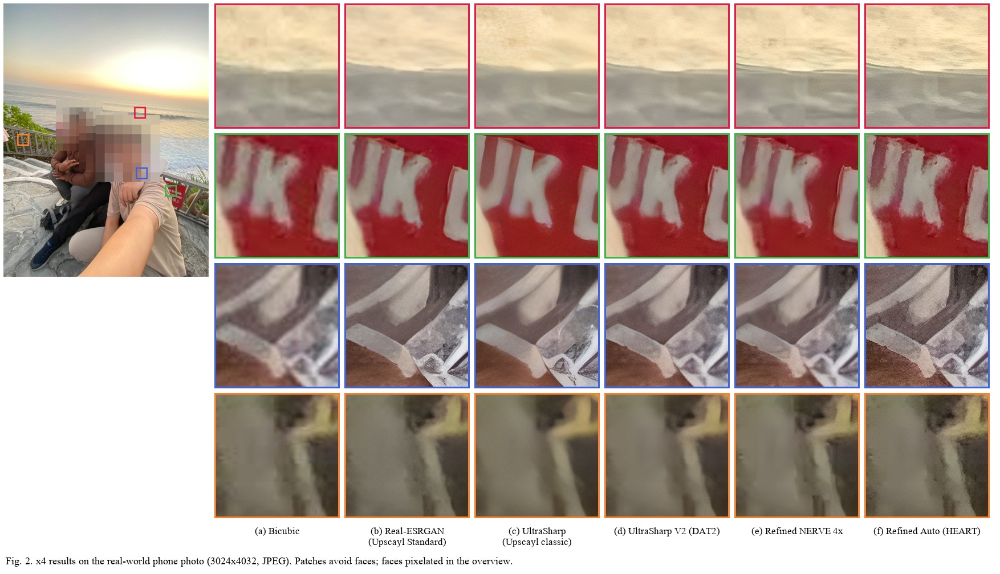

<div align="center">

# Upscayl Refined

**NuRichter Refined Nov Ver.** — a fork of [Upscayl](https://github.com/upscayl/upscayl) 2.15
with a new hybrid processing core. Same simple window, newer models, lighter when idle.


</div>

## What changed

| | Upscayl 2.15 | Upscayl Refined 3.0 |
|---|---|---|
| Engine | NCNN/Vulkan (`upscayl-bin`), ESRGAN-era models | **Refined engine** (ONNX Runtime, DirectML/WebGPU/CPU) **plus** the classic engine |
| Newest model | 2023–2024 ESRGAN variants | HEART / NERVE / PULSE (Nov 2026), network-interpolated, colour-locked |
| Per-image routing | — | **Refined Auto**: analyses JPEG blocking, noise, blur, art vs photo, picks model and detail |
| Detail control | — | one slider: faithful ↔ sharp (weight-space interpolation, no extra cost) |
| Idle footprint* | 4 processes, 418 MB, 187 MB private | **3 processes, 330 MB, 135 MB private**, 0 % CPU |
| AI engine at idle | — | not running; starts on the first job, exits after 45 s |
| Network at idle | analytics, news fetch, update check | **none** (only model downloads you ask for) |
| Inputs | png, jpg, webp | + avif, tiff, bmp |

\*Windows 11, RTX 5060 Ti, measured with `qa/idle_bench.mjs`.

Quality on 30 images × 4 degradations (details in
[docs/REFINED_ENGINE.md](docs/REFINED_ENGINE.md)):

| | PSNR clean / web / heavy / soft | mean LPIPS ↓ |
|---|---|---|
| Classic: Upscayl Standard | 27.29 / 26.11 / 25.53 / 27.25 | 0.254 |
| **Refined Auto** | **28.71 / 26.77 / 26.21 / 28.72** | **0.220** |

## Results

All runs are x4 on one machine (Windows 11, RTX 5060 Ti 16 GB, driver 621.24;
ONNX Runtime 1.31.1 DirectML for the Refined engine, upscayl-bin 20251207
Vulkan for the classic one). Two real test images are used: a painted
artwork (1200×672 JPEG) and a phone photo (3024×4032 JPEG, processed as
384×384 windows around each patch). The detail level of the Refined models is
left on Auto unless a row says otherwise.

<p align="center"></p>

**Fig. 1.** ×4 results on the painted-art test image, three 55 px patches
shown 1:1 (220 px). (a) Bicubic, (b) Real-ESRGAN = Upscayl Standard,
(c) UltraSharp (classic), (d) UltraSharp V2 DAT2, (e) Refined NERVE 4x,
(f) Refined Auto (routes to HEART). Artwork © its creator; used here only as a
test image.

<p align="center"></p>

**Fig. 2.** ×4 results on the real-world phone photo: wave crest, sign
lettering, wristwatch, railing. Patches avoid faces; faces are pixelated in the
overview.

**TABLE I.** Full-reference quality on the same two test images. Ground truth
is the original; inputs are its ×4 downscale under four degradations (clean,
JPEG q60, blur+noise+JPEG q40, blur σ1.6), 3 crops per image type, mean of 12
runs. PSNR/SSIM on Y; LPIPS-alex. Best in **bold**.

| Method | Art PSNR ↑ | Art SSIM ↑ | Art LPIPS ↓ | Photo PSNR ↑ | Photo SSIM ↑ | Photo LPIPS ↓ |
|---|---:|---:|---:|---:|---:|---:|
| Bicubic | 24.66 | 0.7271 | 0.5503 | 31.73 | 0.8277 | 0.3990 |
| Real-ESRGAN (Upscayl Standard) [classic] | 26.35 | 0.8027 | 0.2021 | 30.29 | 0.8153 | 0.1926 |
| UltraSharp [classic] | 25.62 | 0.7743 | 0.1885 | 28.68 | 0.7498 | 0.2453 |
| UltraSharp V2, DAT2 (NC) | 27.52 | 0.8376 | **0.1230** | 31.84 | 0.8457 | **0.1579** |
| Refined NERVE 4x | 26.95 | 0.8001 | 0.1829 | 30.83 | 0.8116 | 0.1860 |
| Refined HEART 4x, detail 0 | **28.35** | **0.8435** | 0.1756 | **32.79** | **0.8592** | 0.1830 |
| Refined Auto (ours, default) | 27.61 | 0.8262 | 0.1351 | 30.93 | 0.8157 | 0.1601 |

**TABLE II.** No-reference quality of the ×4 outputs of the *real* inputs
(no ground truth exists). pyiqa 0.1.16: MUSIQ, CLIP-IQA, MANIQA (higher is
better), NIQE (lower is better). Photo = mean over the four windows.

| Method | Art MUSIQ ↑ | Art CLIPIQA ↑ | Art MANIQA ↑ | Art NIQE ↓ | Photo MUSIQ ↑ | Photo CLIPIQA ↑ | Photo MANIQA ↑ | Photo NIQE ↓ |
|---|---:|---:|---:|---:|---:|---:|---:|---:|
| Bicubic | 32.04 | 0.655 | 0.317 | 6.65 | 20.55 | 0.388 | 0.250 | 8.83 |
| Real-ESRGAN (Upscayl Standard) [classic] | **48.97** | 0.642 | 0.383 | 5.44 | 34.63 | 0.387 | 0.290 | 5.83 |
| UltraSharp [classic] | 27.57 | **0.722** | **0.468** | 5.15 | 44.45 | **0.500** | 0.295 | **4.84** |
| UltraSharp V2, DAT2 (NC) | 34.04 | 0.679 | 0.439 | 5.33 | 36.04 | 0.340 | 0.269 | 6.23 |
| Refined NERVE 4x | 48.54 | 0.548 | 0.310 | **4.95** | 34.46 | 0.300 | 0.252 | 5.20 |
| Refined Auto (ours, default) | 48.31 | 0.603 | 0.345 | 5.34 | **48.08** | 0.469 | **0.308** | 5.32 |

**TABLE III.** Time for the art image (1200×672 → 4800×2688), model load
included.

| Method | Engine | Params | Time (s) ↓ |
|---|---|---:|---:|
| Real-ESRGAN (Upscayl Standard) [classic] | NCNN/Vulkan | 16.7 M | 4.7 |
| UltraSharp [classic] | NCNN/Vulkan | 16.7 M | 4.7 |
| UltraSharp V2, DAT2 (NC) | ONNX/DirectML | ~11 M | 29.5 |
| Refined NERVE 4x | ONNX/DirectML fp16 | 1.8 M | 1.6 |
| Refined Auto (ours, default) | ONNX/DirectML fp16 | 16.7 M | 20.8 |


**Discussion.** Against Upscayl's default (Real-ESRGAN), Refined Auto
lowers LPIPS by 33 % on art and 17 % on photos (Table I) while raising PSNR on
art, and it is the best no-reference result on the real photo in MUSIQ and
MANIQA (Table II). The detail dial spans the perception–distortion range
inside one model: detail 0 gives the highest PSNR/SSIM of every method in
Table I, Auto trades some of that for LPIPS. UltraSharp V2 (DAT2) is the
strongest on LPIPS but is non-commercial and 1.4× slower than HEART, so it is
offered as an optional download only. No-reference metrics disagree with each
other (UltraSharp classic leads CLIP-IQA/NIQE on the photo, Real-ESRGAN leads
MUSIQ on the art), so the full-reference numbers are the primary evidence. On
heavily compressed phone JPEGs the Auto setting (detail 0.95) can look
slightly painterly (Fig. 2, watch); lowering Detail to ~0.5 gives a cleaner,
more literal result. NERVE is the fastest model in the app (1.6 s, 1.8 M
parameters). The 30-image benchmark with Kodak is in
[docs/REFINED_ENGINE.md](docs/REFINED_ENGINE.md).

## Models

| Model | Best for | Licence | Shipped |
|---|---|---|---|
| Refined Auto (Smart Hybrid) | anything; picks HEART ≤ 8 MP, NERVE above | — | ✓ |
| Refined HEART 4x | best quality photos/art (transformer) | Apache-2.0 | ✓ |
| Refined NERVE 4x | fast restoration of photos, JPEGs, phone shots | Apache-2.0 | ✓ |
| Refined NERVE 2x | fast native 2x | Apache-2.0 | ✓ |
| Refined PULSE 4x | instant, clean inputs | MIT | ✓ |
| Refined HEART 2x | clean native 2x | Apache-2.0 | download |
| UltraSharp V2 / V2 Lite | art and illustrations | CC BY-NC-SA 4.0 | download |
| Upscayl classic models (7) | as before | see upstream | ✓ |

Custom models: drop `.onnx` files (Refined engine) or `.param/.bin` pairs
(classic engine) in a folder named `models` and pick it in Settings.

## Use

Download the installer from [Releases](https://github.com/NuRichter/upscayl-refined/releases).
It installs per user next to the original Upscayl without touching it.

Headless:

```
node export/electron/engine/cli.js -i photo.jpg -o photo_4x.png -m refined-auto
node export/electron/engine/cli.js -i photo.jpg --analyze
```

## Build

```
npm install
npm run build          # tsc + translations + Next static export
npm test               # engine unit tests
npx electron-builder --win
```

Rebuild the Refined models from their pinned upstream checkpoints
(Python with `onnx onnxruntime onnxconverter-common numpy`):

```
python -I tools/model-forge/build.py
```

## Docs

* [docs/REFINED_ENGINE.md](docs/REFINED_ENGINE.md) — architecture, model forge, QA numbers
* [docs/REFERENCES.md](docs/REFERENCES.md) — sources behind the design
* [resources/refined-models/NOTICE.md](resources/refined-models/NOTICE.md) — model licences and changes
* [docs/UPSTREAM_README.md](docs/UPSTREAM_README.md) — the original Upscayl README

## Credits

Upscayl by Nayam Amarshe and TGS963 and its contributors (AGPL-3.0).
HEART, NERVE and PULSE by Philip Hofmann (Phhofm). UltraSharp V2 by Kim2091.
Real-ESRGAN by Xintao Wang et al. ONNX Runtime by Microsoft. sharp/libvips.

Licensed under AGPL-3.0, like Upscayl.
